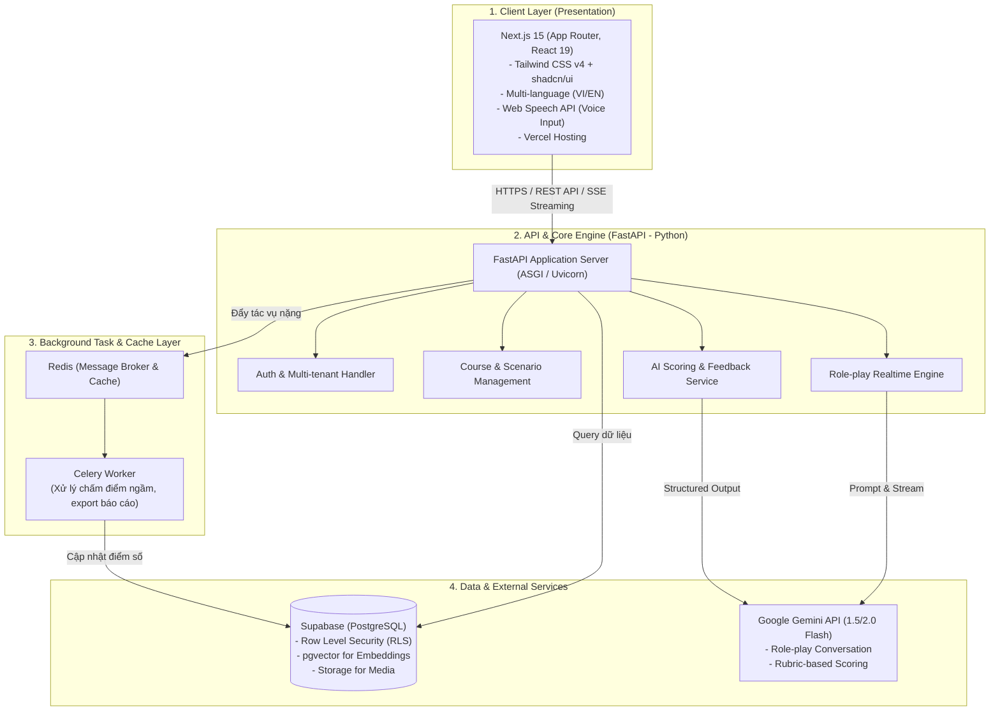
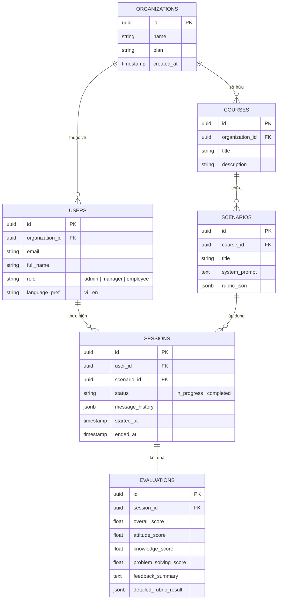
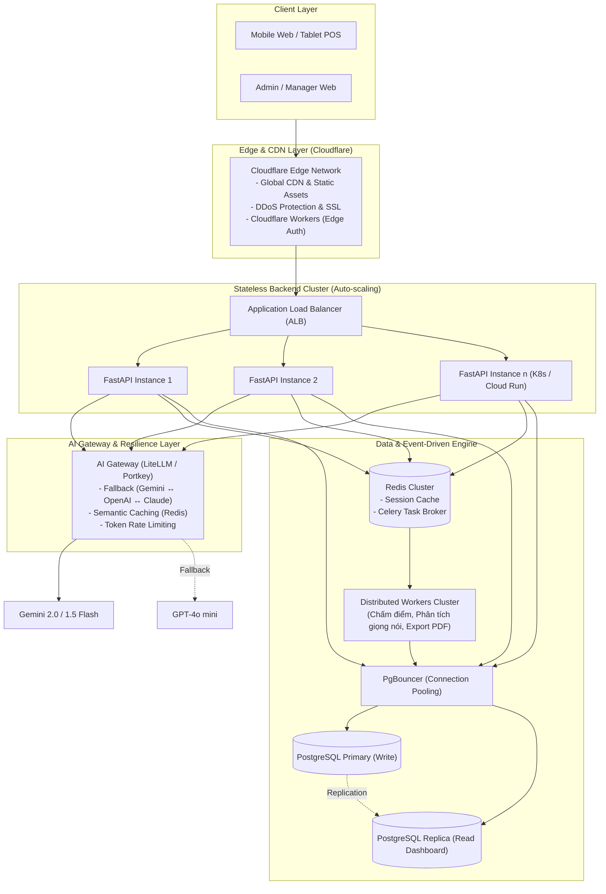

# ⚙️ TÀI LIỆU KỸ THUẬT HỆ THỐNG (TECHNICAL SPECIFICATION)

> **Dự án:** Hệ thống Đào tạo & Đánh giá Kiến thức Nền tảng F&B bằng AI (**Rolly**)  
> **Phiên bản:** 1.0  
> **Đối tượng:** Đội ngũ Kỹ sư Phát triển (Frontend, Backend, AI, DevOps) & Ban Cố vấn Công nghệ.

---

## 📑 Mục lục
1. [Tổng quan Kiến trúc Hệ thống](#1-tổng-quan-kiến-trúc-hệ-thống)
2. [Bảng Chi tiết Tech Stack](#2-bảng-chi-tiết-tech-stack)
3. [Phân tích Quyết định: Tại sao Backend dùng Python (FastAPI)?](#3-phân-tích-quyết-định-tại-sao-backend-dùng-python-fastapi)
4. [Thiết kế Chi tiết Các Phân hệ Cốt lõi](#4-thiết-kế-chi-tiết-các-phân-hệ-cốt-lõi)
5. [Thiết kế Cơ sở Dữ liệu & Cơ chế Multi-Tenant](#5-thiết-kế-cơ-sở-dữ-liệu--cơ-chế-multi-tenant)
6. [Quy trình Tương tác AI (Role-play & Scoring Pipeline)](#6-quy-trình-tương-tác-ai-role-play--scoring-pipeline)
7. [Tiêu chuẩn Frontend & Trải nghiệm Người dùng](#7-tiêu-chuẩn-frontend--trải-nghiệm-người-dùng)
8. [Hạ tầng Triển khai & Chi phí Vận hành (DevOps)](#8-hạ-tầng-triển-khai--chi-phí-vận-hành-devops)
9. [Chiến lược Mở rộng Quy mô (Scale-Up Architecture)](#9-chiến-lược-mở-rộng-quy-mô-scale-up-architecture)

---

## 1. Tổng quan Kiến trúc Hệ thống

### Mô hình Đề xuất: **Modular Monolith kết hợp Event/Async Worker**

Hệ thống được thiết kế theo mô hình **Monolith thông minh (Modular Monolith)** nhằm tối ưu tốc độ bàn giao sản phẩm (Time-to-market), tiết kiệm chi phí hạ tầng và đơn giản hóa quy trình vận hành cho đội ngũ kỹ thuật 3–4 người, trong khi vẫn tách bạch ranh giới các module để sẵn sàng chuyển đổi khi mở rộng.



> **Lý do không chọn Microservices ở giai đoạn đầu:**  
> Đội ngũ quy mô 3–4 người sẽ mất quá nhiều thời gian vào hạ tầng (Service Discovery, Distributed Tracing, Network Latency, Data Consistency). Mô hình Modular Monolith có cấu trúc code phân tầng rõ ràng, triển khai nhanh và dễ debug hơn rất nhiều.

---

## 2. Bảng Chi tiết Tech Stack

| Tầng hệ thống | Công nghệ lựa chọn | Vai trò trong hệ thống | Lý do lựa chọn |
| :--- | :--- | :--- | :--- |
| **Frontend Framework** | **Next.js 15** (App Router, TypeScript) | Giao diện Web, SSR/SSG, Server Actions | Tối ưu SEO, hiệu năng cao, hệ sinh thái phong phú, dễ stream dữ liệu. |
| **UI Component Library** | **Tailwind CSS v4** + **shadcn/ui** | Design System & Styling | Đẹp chuẩn SaaS hiện đại, gọn nhẹ, toàn quyền kiểm soát mã nguồn component. |
| **Animation & Micro-UX** | **Framer Motion** | Hiệu ứng Typewriter, chuyển trang | Mang lại cảm giác mượt mà (wow factor) cho người dùng khi AI phản hồi. |
| **Frontend State** | **TanStack Query** + **Zustand** | Quản lý Server Cache & Global State | Tự động re-fetch, caching thông minh, giảm tải số lượng request lên server. |
| **Đa ngôn ngữ** | **next-intl** / **i18next** | Bản địa hóa Song ngữ VI / EN | Nhân viên và quản lý chuyển đổi ngôn ngữ tức thời không cần tải lại trang. |
| **Backend Framework** | **FastAPI** (Python 3.12+) | RESTful API, SSE Streaming, AI Orchestrator | Xử lý bất đồng bộ native, tốc độ cao, tích hợp mượt mà với thư viện AI. |
| **Data Validation** | **Pydantic v2** | Kiểm thực dữ liệu & DTO | Viết bằng Rust, parse dữ liệu cực nhanh, tự động sinh tài liệu Swagger UI `/docs`. |
| **Database & Auth** | **Supabase (PostgreSQL)** | Cơ sở dữ liệu chính + Xác thực + File Storage | Tích hợp RLS (Row Level Security), có sẵn pgvector cho AI RAG, quản lý người dùng tập trung. |
| **Async Task & Cache** | **Redis + Celery** | Hàng đợi công việc (Job Queue) & Cache phiên | Tách biệt các tác vụ nặng (chấm điểm theo rubric, gửi mail báo cáo) khỏi luồng chính. |
| **AI LLM Model** | **Google Gemini 1.5/2.0 Flash** | Đóng vai khách hàng & Chấm điểm | Chi phí siêu rẻ ($0.075/1M input tokens), tốc độ phản hồi <1.5s, hỗ trợ tiếng Việt xuất sắc. |
| **Xử lý Giọng nói** | **Web Speech API** (Fallback: Whisper) | Nhận diện tiếng nói trực tiếp trên trình duyệt | 0đ chi phí xử lý giọng nói, chạy trực tiếp trên client, phản xạ tương tác tự nhiên. |

---

## 3. Phân tích Quyết định: Tại sao Backend dùng Python (FastAPI)?

Nhiều nhà phát triển thường đặt câu hỏi: *Tại sao không dùng Node.js/NestJS để đồng bộ ngôn ngữ TypeScript với Frontend, hoặc dùng Go để tối ưu tốc độ?*

Dưới đây là các luận điểm kỹ thuật quyết định việc lựa chọn **Python (FastAPI)**:

### 1. Vị thế độc tôn trong Hệ sinh thái AI & Xử lý Âm thanh
* **SDK chính thức & tính năng mới:** Mọi đột phá mới nhất từ Google DeepMind (Gemini), OpenAI, Anthropic, hay open-source (HuggingFace) luôn có thư viện Python trước tiên và đầy đủ nhất.
* **Xử lý nghiệp vụ Audio/NLP chuyên sâu:** Khi hệ thống mở rộng cần phân tích ngữ điệu, tốc độ nói hoặc cắt lát file âm thanh đào tạo, các thư viện như `librosa`, `pydub`, `soundfile`, `whisper` chỉ hoạt động ổn định và mạnh mẽ nhất trên Python.

### 2. Tốc độ thực thi của FastAPI với Asyncio & Pydantic v2
* Khác với Django/Flask thế hệ cũ, FastAPI chạy trên nền tảng **ASGI (Asynchronous Server Gateway Interface)** với `uvloop`, mang lại thông lượng (throughput) xử lý I/O tương đương Node.js và Go.
* Bản chất của ứng dụng AI là **I/O-bound** (chờ phản hồi mạng từ LLM API trong 1–3 giây). Cơ chế `async/await` của FastAPI cho phép 1 tiến trình xử lý hàng ngàn kết nối đồng thời mà không bị block luồng.
* **Pydantic v2** được viết lại bằng **Rust**, giải quyết triệt để bài toán hiệu năng serialize/deserialize JSON.

### 3. Tích hợp Hoàn hảo cho Streaming (SSE)
FastAPI cung cấp khả năng stream response trực tiếp qua giao thức **Server-Sent Events (SSE)** thông qua `StreamingResponse`, cho phép đẩy từng token do Gemini sinh ra về giao diện Next.js theo thời gian thực mà không gặp độ trễ đệm (buffering delay).

### 4. Bảng So sánh Tổng quan Nền tảng Backend

```
+-------------------+-----------------+-------------------+-------------------+-------------------+
| Tiêu chí          | Python (FastAPI)| Node.js (NestJS)  | Golang            | Java (Spring Boot)|
+-------------------+-----------------+-------------------+-------------------+-------------------+
| Tích hợp AI/LLM   | ⭐⭐⭐⭐⭐ Xuất sắc| ⭐⭐⭐ Khá         | ⭐⭐ Hạn chế      | ⭐⭐ Hạn chế      |
| Xử lý I/O Async   | ⭐⭐⭐⭐ Rất tốt   | ⭐⭐⭐⭐⭐ Xuất sắc | ⭐⭐⭐⭐⭐ Xuất sắc| ⭐⭐⭐⭐ Tốt       |
| Tốc độ Dev (MVP)  | ⭐⭐⭐⭐⭐ Cực nhanh | ⭐⭐⭐⭐⭐ Rất nhanh| ⭐⭐⭐ Chặt chẽ    | ⭐⭐ Tốn thời gian|
| Thư viện Audio    | ⭐⭐⭐⭐⭐ Đầy đủ   | ⭐⭐⭐ Trung bình  | ⭐⭐ Ít hỗ trợ    | ⭐⭐⭐ Khá         |
| Tự động sinh Docs | ✅ Swagger sẵn   | ⚠️ Cần config      | ⚠️ Cần viết tool  | ⚠️ Cần plugin     |
+-------------------+-----------------+-------------------+-------------------+-------------------+
```

---

## 4. Thiết kế Chi tiết Các Phân hệ Cốt lõi

### 4.1. Phân hệ Role-play Thời gian thực (Role-play Engine)
* **Mục tiêu:** Mô phỏng cuộc trò chuyện giữa nhân viên và khách hàng với các tính cách khác nhau (khách khó tính, khách vội, khách dị ứng).
* **Luồng xử lý:**
  1. Frontend gửi `user_message` kèm `session_id` lên endpoint `/api/v1/roleplay/chat`.
  2. Backend lấy `chat_history` từ Redis Cache để làm ngữ cảnh.
  3. Ghép nối `system_prompt` của kịch bản (kèm thông tin menu và quy tắc phục vụ).
  4. Gọi Gemini API với tham số `stream=True`.
  5. Đẩy token về Client qua Server-Sent Events (SSE) để hiển thị hiệu ứng chữ chạy.
  6. Lưu câu trả lời hoàn chỉnh vào cơ sở dữ liệu.

### 4.2. Phân hệ Chấm điểm Tự động (AI Evaluation & Scoring Engine)
* **Mục tiêu:** Phân tích toàn bộ cuộc hội thoại sau khi hoàn thành phiên để chấm điểm theo khung tiêu chí (Rubric).
* **Khung tiêu chí chấm điểm 3 trụ cột (Rubric Matrix):**
  * `Attitude` (0 - 100): Dạ thưa, thái độ nhã nhặn, biết nói lời xin lỗi/cảm ơn.
  * `Knowledge` (0 - 100): Hiểu rõ menu món, thành phần dị ứng, thời gian chế biến.
  * `ProblemSolving` (0 - 100): Đưa ra phương án giải quyết thỏa đáng khi khách phàn nàn.
* **Cơ chế Structured Output:**
  * Ép Gemini trả về định dạng JSON nghiêm ngặt thông qua JSON Schema.
  * Trả về chi tiết: Điểm tổng, điểm từng tiêu chí, điểm mạnh, điểm cần cải thiện, và câu mẫu đề xuất.

---

## 5. Thiết kế Cơ sở Dữ liệu & Cơ chế Multi-Tenant

Hệ thống phục vụ mô hình **B2B SaaS**, nơi nhiều thương hiệu nhà hàng (Organizations) dùng chung 1 cơ sở dữ liệu nhưng dữ liệu của thương hiệu nào thì chỉ thương hiệu đó xem được.

### Sơ đồ Thực thể (Entity Relationship Diagram)



### Cơ chế Bảo mật Row Level Security (RLS) trên PostgreSQL:
```sql
-- Ví dụ: Nhân viên chỉ được đọc kịch bản thuộc tổ chức của mình
ALTER TABLE scenarios ENABLE ROW LEVEL SECURITY;

CREATE POLICY "Users can only access their org scenarios"
ON scenarios
FOR SELECT
USING (
  course_id IN (
    SELECT id FROM courses WHERE organization_id = auth.jwt() ->> 'organization_id'
  )
);
```

---

## 6. Quy trình Tương tác AI (Role-play & Scoring Pipeline)

### Chiến lược Quản lý Mô hình & Tối ưu Chi phí:

```python
# Cấu hình phân chia model theo tác vụ (config.py)
ROLEPLAY_MODEL = "gemini-1.5-flash"  # Tốc độ phản hồi cực nhanh, rẻ cho hội thoại liên tục
SCORING_MODEL  = "gemini-1.5-flash"  # Đủ chính xác cho giai đoạn đồ án/MVP
COMMERCIAL_SCORING_MODEL = "gemini-1.5-pro"  # Nâng cấp khi thương mại hóa cần phân tích sâu
```

### Ước tính Chi phí API Gemini 1.5 Flash:
* Input: **$0.075 / 1,000,000 tokens**
* Output: **$0.30 / 1,000,000 tokens**
* Trung bình 1 buổi role-play (8 lượt đối thoại) ≈ 2,500 tokens.
* **1,000 buổi luyện tập chỉ tốn khoảng ~$0.85 USD (≈ 21,000 VNĐ)** $\rightarrow$ Chi phí gần như bằng 0 ở giai đoạn thử nghiệm, biên lợi nhuận cực cao khi thương mại.

---

## 7. Tiêu chuẩn Frontend & Trải nghiệm Người dùng

1. **Streaming UI & Typewriter Effect:** Phản hồi từ AI được hiển thị tức thời từng ký tự; sử dụng Skeleton Loading để loại bỏ hoàn toàn các khung trắng khi tải dữ liệu.
2. **Thiết kế Mobile-First:** Tối ưu hóa cho màn hình điện thoại di động (iPhone / Android) để nhân viên có thể luyện tập nhanh 5–10 phút trước ca làm việc.
3. **Micro-Interactions:** Sử dụng hiệu ứng âm thanh nhẹ và animation khi hoàn thành bài luyện tập để kích thích động lực học tập (Gamification).
4. **Song ngữ VI/EN Liền mạch:** Chuyển đổi ngôn ngữ giao diện không cần reload trang; tự động đồng bộ ngôn ngữ hệ thống với ngôn ngữ kịch bản luyện tập.

---

## 8. Hạ tầng Triển khai & Chi phí Vận hành (DevOps)

### Kiến trúc Triển khai (Deployment Topology)

```
[ Domain: rolly.vn ]
         │
         ├──▶ / (Frontend)         ──▶ Vercel Edge Network
         ├──▶ /api/* (Backend)     ──▶ Railway / Render (FastAPI Docker Container)
         ├──▶ Redis Task Queue     ──▶ Railway Redis
         └──▶ Database & Storage   ──▶ Supabase Cloud (PostgreSQL Singapore Region)
```

### Chi phí Dự toán Hàng tháng:

| Dịch vụ | Giai đoạn Đồ án / MVP | Giai đoạn Thương mại (100 quán) |
| :--- | :--- | :--- |
| **Frontend (Vercel)** | $0 (Hobby Plan) | $20 / tháng (Pro Plan) |
| **Backend & Redis (Railway)** | $0 - $5 / tháng (Hobby Credit) | $20 - $40 / tháng |
| **Database (Supabase)** | $0 (Free Tier 500MB) | $25 / tháng (Pro Plan) |
| **AI API (Google Gemini)** | $0 (Free tier 1,500 req/ngày) | $15 - $30 / tháng |
| **TỔNG CỘNG** | **$0 - $5 / tháng** | **~$80 - $115 / tháng** |

---

## 9. Chiến lược Mở rộng Quy mô (Scale-Up Architecture)

Khi hệ thống mở rộng từ đồ án/MVP lên phục vụ hàng chục ngàn nhân viên F&B trên toàn quốc, các điểm nghẽn kỹ thuật sẽ chuyển dịch sang: **Giới hạn Rate-limit của AI, Độ trễ kết nối Streaming (SSE), Quá tải Pool kết nối Database và Ùn tắc Hàng đợi Chấm điểm**.

### 9.1. Sơ đồ Kiến trúc Scale-Up Đa Tầng



### 9.2. Các Giải pháp Kỹ thuật Trọng yếu

1. **AI Gateway & Semantic Caching:**
   * **Semantic Caching:** Sử dụng Redis + Vector Search để lưu đệm các phản hồi cho tình huống tương đương. Nếu nhân viên hỏi cùng 1 câu hỏi về menu, hệ thống trả về kết quả từ cache trong **<50ms (chi phí 0đ)** thay vì gọi lại LLM.
   * **Auto-Fallback:** Cổng AI Gateway (LiteLLM) tự động chuyển hướng sang GPT-4o mini hoặc Claude 3.5 Haiku nếu Gemini chạm ngưỡng Rate Limit (`429 Too Many Requests`).

2. **Tối ưu Database: Connection Pooling & Read Replicas:**
   * **PgBouncer / Supavisor:** Đóng vai trò lớp gom kết nối (Connection Pooler), cho phép hàng chục ngàn client kết nối đồng thời mà không làm sập PostgreSQL limit (~100-200 connections).
   * **CQRS (Phân tách Đọc/Ghi):** Mọi thao tác ghi (nộp bài, tạo session) đi vào Primary DB; toàn bộ truy vấn xem dashboard, thống kê của hàng ngàn Quản lý được điều hướng sang Read Replica.

3. **Stateless Backend & Horizontal Pod Autoscaler (HPA):**
   * Backend FastAPI được thiết kế phi trạng thái (Stateless). Toàn bộ session hội thoại tạm thời lưu trên Redis Cluster.
   * Cụm container tự động scale từ 2 pods lên 20 pods trong vòng 60 giây khi vào khung giờ cao điểm giao ca làm việc (10h00 và 14h00).

4. **Dynamic Worker Scaling:**
   * Tách biệt hoàn toàn máy chủ xử lý HTTP và máy chủ chấm điểm. Khi nhân viên nộp bài, API trả về thành công trong **5ms** và đẩy bài thi vào Celery Queue.
   * Đội ngũ worker phía sau tự động scale theo độ dài hàng đợi, đảm bảo không bao giờ làm nghẽn giao diện người dùng.

---

### 9.3. Bảng Lộ trình Tiến hóa Quy mô (Scaling Roadmap)

| Giai đoạn | Quy mô (MAU / Chi nhánh) | Kiến trúc & Hạ tầng | Chi phí ước tính |
| :--- | :--- | :--- | :--- |
| **Giai đoạn 1: MVP / Đồ án** | < 1,000 users / 5–10 quán | **Modular Monolith** trên Railway + Vercel + Supabase Free tier. | **$0 – $20 / tháng** |
| **Giai đoạn 2: Early Growth** | 5,000 – 30,000 users / 50–200 quán | **Multi-container FastAPI** + Redis Queue + PgBouncer + Gemini Paid Tier. | **$150 – $350 / tháng** |
| **Giai đoạn 3: Enterprise Scale** | > 100,000 users / Chuỗi toàn quốc | **Event-Driven Services** (K8s) + AI Gateway + Read Replica DB + Cloudflare Enterprise. | **$800 – $2,000 / tháng** |

---

*Tài liệu được cập nhật và phê duyệt bởi Bộ phận Kỹ thuật Dự án Rolly.*
